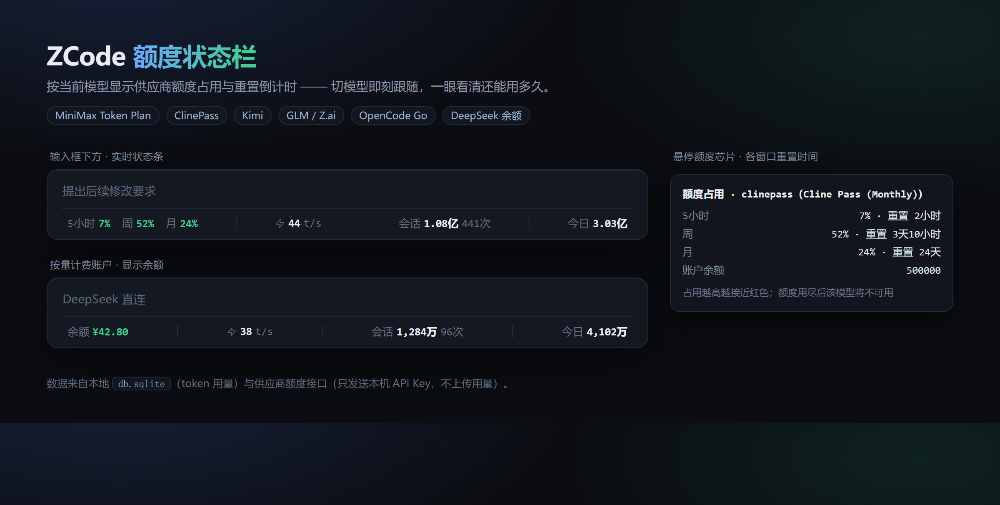

<div align="center">

# ZCode 额度状态栏

**当前模型的额度还剩多少、什么时候重置 —— 一眼看清。**

给 [ZCode](https://zcode.z.ai) 对话窗口加一条实时状态栏：按当前模型显示供应商的套餐额度、生成速度和 token 用量。

简体中文 · [English](README.en.md) · 本文件与 [README.md](README.md) 内容相同（保留路径以兼容旧链接）

Windows / macOS / Linux · Python 3.8+ · [MIT](LICENSE)



</div>

## 它能做什么

- **看额度**：按当前模型显示 5 小时 / 周 / 月 三个窗口的占用百分比，颜色随占用从绿到红，用尽前就该知道。
- **看重置**：悬停每个窗口，显示还有多久重置（`3天10小时`）。
- **跟模型**：切换模型时额度立刻跟着换供应商，不用等下一次请求落库。
- **看速度**：生成速度 tok/s（含思考），以及首字等待时间。
- **看消耗**：当前会话累计 token / 请求次数，以及今日合计。
- **按量计费也支持**：没有套餐窗口的账户（如 DeepSeek）直接显示账户余额。
- **纯本地优先**：token 数据只读本地 SQLite，不联网；只有额度查询会请求供应商接口。

## 支持的供应商

### 套餐窗口（5 小时 / 周 / 月）

| 供应商 | 显示 | 数据来源 |
|---|---|---|
| **MiniMax Token Plan** | 5 小时窗口；套餐有周限额时加周窗口 | `api.minimaxi.com/v1/api/openplatform/coding_plan/remains` |
| **ClinePass** | 5 小时 / 周 / 月 + 套餐名 + 余额 | `api.cline.bot/api/v1/users/me/plan/usage-limits` |
| **Kimi** | 5 小时 / 周（有月度池时加月） | `api.kimi.com/coding/v1/usages` |
| **GLM / Z.ai** | 5 小时 token 窗口 + 套餐等级 | `open.bigmodel.cn/api/monitor/usage/quota/limit` |
| **OpenCode Go** | 滚动 / 周 / 月 | `opencode.ai/zen/go/v1/usage` |
| **Command Code** | 5 小时 / 周 + 剩余额度 | `api.commandcode.ai/alpha/billing/*` |

### 账户余额（按量计费）

| 供应商 | 数据来源 |
|---|---|
| **DeepSeek** | `api.deepseek.com/user/balance` |
| **Moonshot** | `api.moonshot.cn|.ai/v1/users/me/balance` |
| **SiliconFlow** | `api.siliconflow.cn/v1/user/info` |
| **StepFun** | `api.stepfun.com/v1/accounts` |
| **OpenRouter** | `openrouter.ai/api/v1/credits` |
| **Novita** | `api.novita.ai/openapi/v1/billing/balance/detail` |
| **Ollama Cloud** | `ollama.com/api/balance` |

**Xiaomi MiMo**：目前只有模型接口可以用 API Key 访问，余额和套餐用量需要登录网页控制台（Cookie），所以插件的处理是——检测到该供应商就不显示额度，不会编一个数字出来。

不在这张表里的供应商（例如自建的 OpenAI 兼容中转）不会发起任何请求，状态栏保持原样。

## 安装

### 方式一：从插件市场（推荐）

1. 打开 ZCode **设置 → 插件 → 插件市场 → 添加 → 添加插件市场**
2. 填入仓库地址：

```text
Clannadad/zcode-token-usage-statusbar
```

3. 在 **个人** 标签下找到 **ZCode Token Usage Statusbar**，点击安装
4. **完全退出 ZCode 并重新打开**（只关窗口不算退出）

> 状态栏需要向客户端注入一小段加载器（会修改 `app.asar`）。安装成功后必须完全退出重启才会出现。卸载时只移除这段注入，不回滚客户端版本。

### 方式二：本地目录

克隆仓库后，在 **添加插件市场** 里点击 **选择目录**，选中仓库根目录（包含 `marketplace.json` 的那一层），再安装插件。

### 方式三：一键安装（不通过插件）

```bash
python install.py --root "D:\Zoey\ZCode"
```

`--root` 指向 ZCode 安装目录（含 `resources/app.asar`）。脚本会复制运行文件、注册 MCP、注入状态栏。运行中替换失败时会弹一个监控窗口，完全退出 ZCode 后自动完成。

## 配置

默认运行配置在 `~/.zcode/zcode-token-usage-statusbar/config.json`。**只改需要的字段，保留其它设置。**

```json
{
  "quota": { "enabled": true, "poll_ms": 60000, "timeout_s": 15 },
  "activity_min_ms": 1500,
  "heartbeat_ms": 30000,
  "hot_reload": true,
  "answer_rate_line": true
}
```

| 字段 | 说明 |
|---|---|
| `quota.enabled` | 额度查询开关，默认 `true`。设为 `false` 后不产生任何额度网络请求，回到纯本地模式 |
| `quota.poll_ms` | 额度刷新间隔，默认 60000（1 分钟）。额度是慢变量，不需要更小 |
| `quota.timeout_s` | 单次额度查询超时，默认 15 秒 |
| `activity_min_ms` | 活跃期 token 查询的最小间隔，默认 1500ms |
| `heartbeat_ms` | 文件事件丢失时的兜底检查间隔，默认 30000ms |
| `answer_rate_line` | 回答末尾的速率统计行，默认开 |

⚠️ JSON 不能带注释，请只合并需要的字段。

## 数据与隐私

- **token 数据**：只读本地 `~/.zcode/cli/db/db.sqlite`，不联网、不上传。
- **额度数据**：读取 ZCode 自己的 `provider_config.json` 里的 API Key（与你在客户端里配置的完全一致，插件里不用再填一遍），只用于向供应商接口请求额度。
- **密钥不会离开查询进程**：不写入快照、不进入渲染进程、不打印日志、不上传。
- **唯一会联网的部分**是额度查询，它只发送 API Key，不发送任何用量数据。可用 `quota.enabled: false` 彻底关闭。
- 插件更新会从已配置的来源下载代码，这是另一条网络路径。

## 它是怎么工作的

```
ZCode 主进程（注入的 inject-main.cjs）
   ├── zusage.py serve   ← 读本地 SQLite，回答 token 用量
   └── quota.py          ← 读 provider 配置，问供应商接口要额度
        ↓ 合并成一份快照
   overlay.js（渲染进程里的状态栏）
        ↓ 按当前模型挑供应商
   5小时 7%   周 52%   月 24%   |   ⚡ 44 t/s   |   会话 1.08亿 441次   |   今日 3.03亿
```

- 额度查询独立于 token 查询：慢变量走独立的进程与 60 秒缓存，不拖慢高频的 token 刷新。
- 额度归属优先取**界面上当前选中的模型**，取不到才退回数据库里最近一条请求的 provider。
- 供应商改了接口结构时，该供应商显示为不可用（悬停可看到原因），状态栏其余部分不受影响。

## 常见问题

**状态栏没有出现？**
保持插件启用，新建或重新打开会话触发注入，然后**完全退出 ZCode**（托盘退出，不是关窗口）。注入失败时手动执行：

```text
/install-overlay
```

**额度一直不显示？**
悬停状态栏任意位置看是否有提示；或查看运行目录下的 `diag-0.json` 里的 `quota` 字段，它会写明当前选中的 provider、拿到的窗口数、以及失败原因。

**切换模型后额度没变？**
插件优先读界面上显示的模型名。如果界面没真正切过去（请求仍走旧供应商），状态栏会保持旧额度——这是如实反映。

**更新 ZCode 后状态栏消失？**
客户端更新会覆盖注入。保持插件启用并新建会话即可自动修复，成功后再完全重启一次。

## 开发与测试

```bash
python3 sync_plugin.py --check                                  # 插件副本与根源码是否一致
python3 -B -m unittest discover -s tests -p 'test_*.py'         # Python 回归
node --test tests/*.test.cjs                                    # Node 回归
node --check overlay.js && node --check inject-main.cjs          # 语法检查
```

- `quota.py` 的适配器全部是纯函数 + 一次 HTTP，可用 `tests/test_quota.py` 的离线夹具验证解析逻辑，不需要真实 Key。
- 改完根源码要跑 `python3 sync_plugin.py` 同步插件副本。

## 卸载

1. 在 ⚙ 里关闭自动更新
2. 运行 `/uninstall-overlay`（保留防重注入标记）
3. **设置 → 插件 → 已安装 → 卸载**
4. 完全退出并重开 ZCode，确认状态栏消失

## 致谢

本项目基于 [ByteRax/zcode-token-usage-statusbar](https://github.com/ByteRax/zcode-token-usage-statusbar)（MIT）改造，在其速度与 token 统计的基础上增加了供应商额度显示、显示项精简和本地插件市场分发。

供应商额度接口的字段结构参考了 [cc-switch](https://github.com/farion1231/cc-switch)、[CodexBar](https://github.com/steipete/CodexBar)、[ai-usagebar](https://github.com/akitaonrails/ai-usagebar) 等项目的公开实现。

[MIT License](LICENSE)
